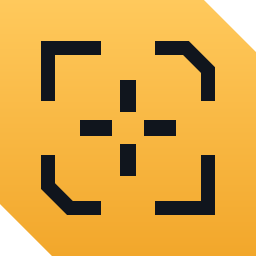
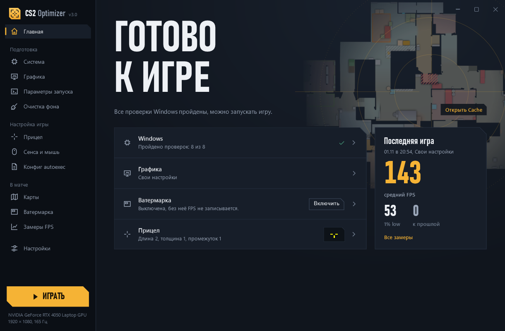
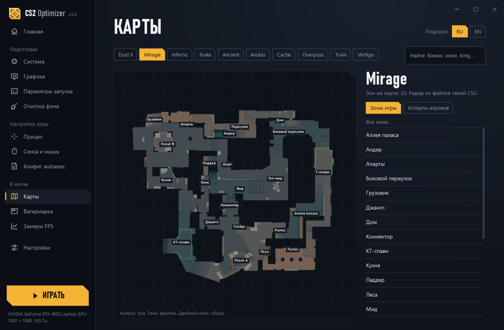
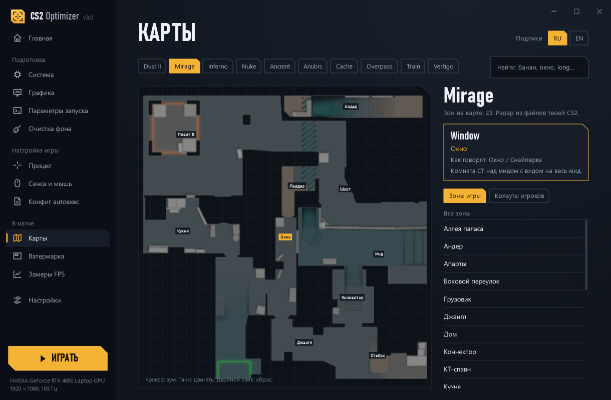
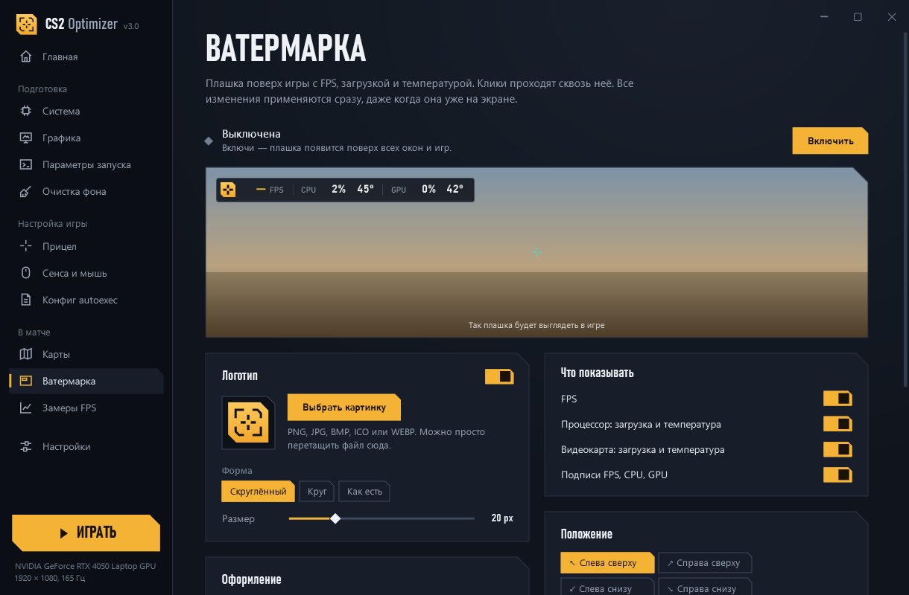
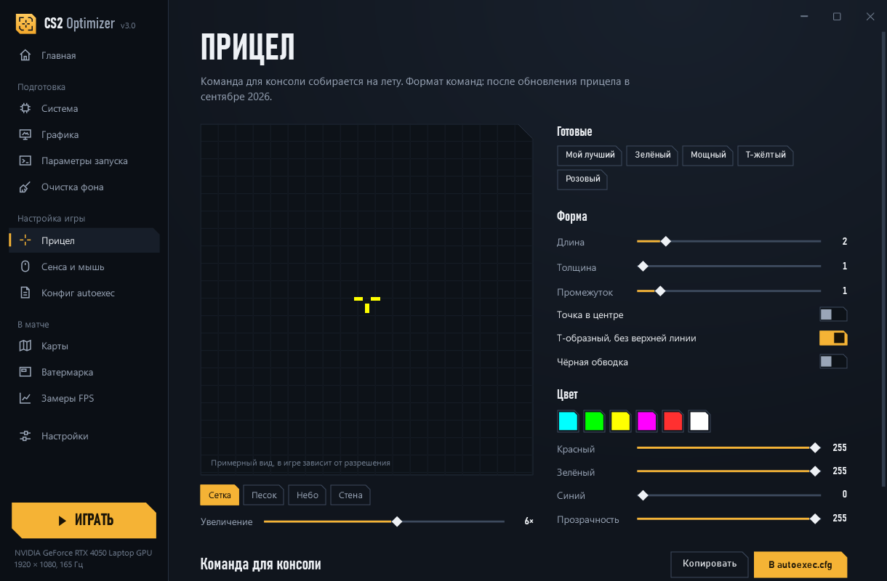
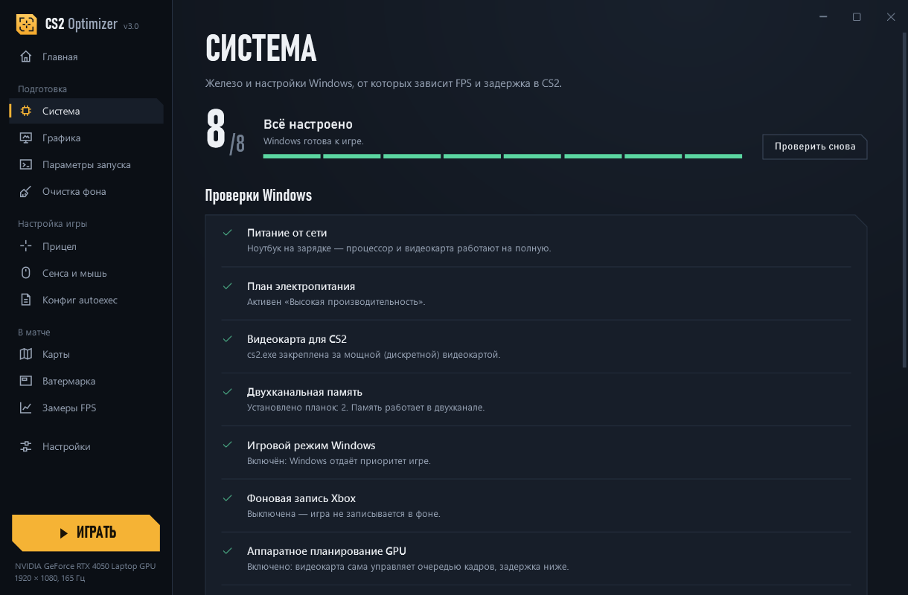
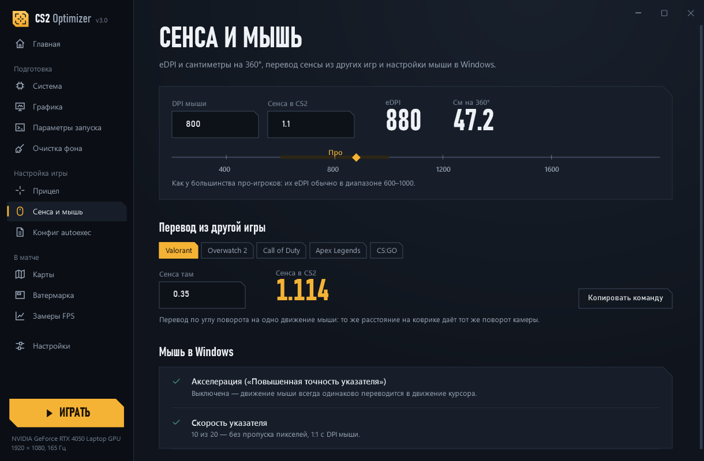

<p align="center"></p>

<h1 align="center">CS2 Optimizer</h1>

<p align="center">Оптимизация Windows и настроек Counter-Strike 2 в одном окне: пресеты графики, конструктор прицела, сенса, autoexec, радары карт с позициями и ватермарка с FPS поверх игры.</p>

<p align="center"></p>

## Скачать

**[Последний релиз → CS2Optimizer.zip](../../releases/latest)** — один `CS2Optimizer.exe`, ничего ставить не нужно (.NET уже внутри). Windows 10/11, x64.

> Программа без цифровой подписи, поэтому Windows покажет SmartScreen: **«Подробнее» → «Выполнить в любом случае»**.

## Что умеет

| Раздел | Что делает |
|---|---|
| **Главная** | Показывает, всё ли готово к игре: проверки Windows, пресет графики, ватермарка, прицел и результат последней игры. Из каждой строки можно перейти в нужный раздел. |
| **Система** | Проверяет питание, план электропитания, видеокарту для CS2 (на ноутбуках с двумя GPU), двухканальную память, игровой режим, фоновую запись Xbox, планирование GPU, оптимизацию оконных игр. Почти всё исправляется одной кнопкой, и каждое изменение можно вернуть. |
| **Графика** | Пресеты «Максимум FPS / Баланс / Качество» для `cs2_video.txt` с таблицей «сейчас → станет» и резервной копией. |
| **Параметры запуска** | Читает текущую строку из Steam и собирает новую с объяснением каждого параметра. |
| **Очистка фона** | Показывает, что ест память, и закрывает выбранное (системные процессы, Steam и CS2 не трогает). Запоминает правила: «всегда закрывать» или «не трогать». |
| **Прицел** | Конструктор с превью и командами в новом формате (после обновления прицела в сентябре 2026). |
| **Сенса и мышь** | eDPI, см/360°, перевод сенсы из Valorant / Overwatch 2 / CoD / Apex, проверка акселерации мыши. |
| **Конфиг autoexec** | Полезные команды (лимит FPS, пинг и FPS в HUD, радар, звук) отдельным блоком в `autoexec.cfg`. |
| **Карты** | Радар каждой карты с зонами из файлов игры и подписями, как их называют игроки (RU и EN), зум колесом, плюс справочник колаутов с русским сленгом. |
| **Ватермарка** | Плашка поверх игры: FPS, загрузка и температура CPU/GPU. Стиль, цвет, размер и угол настраиваются. **Логотип можно заменить своей картинкой** (PNG, JPG, BMP, ICO, WEBP) и выбрать форму: скруглённый, круг или как есть. **Бинд** (по умолчанию `Alt+W`) прячет и показывает плашку прямо в игре. |
| **Замеры FPS** | Каждая игра записывается сама и сохраняется раз в минуту: средний FPS, 1% low, максимальные температуры и сравнение с прошлой сессией. На странице виден статус записи и журнал. |
| **Настройки** | Трей, автозапуск с Windows, ватермарка при старте, кнопка «Играть», обновления, кеш карт, сброс. |
| **Кнопка «Играть»** | Одним нажатием закрывает лишние программы (по твоим правилам), включает ватермарку и запускает CS2. |

> Бинд ватермарки работает, пока CS2 Optimizer запущен — в том числе свёрнутым в трей. Сочетание меняется в разделе «Ватермарка».

<p align="center">
  
  
</p>
<p align="center">
  
  
</p>
<p align="center">
  
  
</p>

## Автообновление

Начиная с версии 2.3 приложение раз в час проверяет релизы этого репозитория и скачивает новую версию в фоне. Устанавливается только файл, чья контрольная сумма SHA-256 совпала с указанной на GitHub. Перезапуск происходит, только когда закрыты CS2 и ватермарка, а окно свёрнуто, либо при выходе из приложения. Отключается в настройках.

## Карты и позиции

- **Радары и зоны** приложение берёт прямо из файлов установленной CS2 (`env_cs_place` — те же зоны, что игра пишет рядом с ником тиммейта). Сами карты не скачиваются, после патчей обновляется само.
- **Колауты игроков** — около 500 позиций по 10 картам с русскими названиями и описаниями. Сверены по [csdb.gg](https://csdb.gg/callouts), [cs2pulse.com](https://cs2pulse.com/callouts), [profilerr.net](https://profilerr.net/all-mirage-callouts) и [hotspawn.com](https://www.hotspawn.com/) в октябре и ноябре 2026, русские названия ещё и по [esports.ru](https://esports.ru/) и [cyber.sports.ru](https://cyber.sports.ru/) в ноябре 2026. Единого списка нет, источники местами расходятся.
- Active Duty (октябрь 2026): Ancient, Anubis, Cache, Dust II, Inferno, Mirage, Nuke. Overpass, Train и Vertigo тоже есть.

## Совместимость

| | |
|---|---|
| Видеокарта NVIDIA | загрузка и температура GPU |
| Видеокарта AMD / Intel | загрузка GPU через счётчики Windows; температура — «—» (Windows её не отдаёт без драйверов производителя) |
| Температура CPU | с датчика платы (ACPI), есть не на всех ПК |
| FPS в ватермарке | любая видеокарта (DirectX 11/12), нужен запуск ватермарки от администратора; с `-vulkan` может не считаться |
| Поверх игры | гарантированно в режиме «Окно без рамки» |

## Безопасность и VAC

Приложение **не трогает процесс игры и её память**. Оно только меняет файлы настроек (`cs2_video.txt` — с резервной копией, `autoexec.cfg` — отдельным блоком), читает файлы карт и меняет настройки Windows по кнопке. Ватермарка — обычное прозрачное окно поверх экрана, FPS считается системным трейсингом Windows (как в PresentMon), без инъекций. Своя иконка один раз переводится в PNG в папке настроек приложения, и ватермарка читает только эту копию.

## Сборка из исходников

```bash
dotnet publish -c Release -r win-x64 --self-contained true -p:PublishSingleFile=true -p:IncludeNativeLibrariesForSelfExtract=true -p:EnableCompressionInSingleFile=true -p:DebugType=None -o publish
```

Нужен .NET 10 SDK. Иконка собирается скриптом `tools/make-icon.ps1` из `Themes/Logo.xaml`.

Используются [ValvePak и ValveResourceFormat](https://github.com/ValveResourceFormat/ValveResourceFormat) (MIT) для чтения файлов Source 2 и [TraceEvent](https://github.com/microsoft/perfview) (MIT) для счётчика FPS.

## Лицензия

[MIT](LICENSE). Counter-Strike 2 и все материалы игры принадлежат Valve; проект не связан с Valve.
